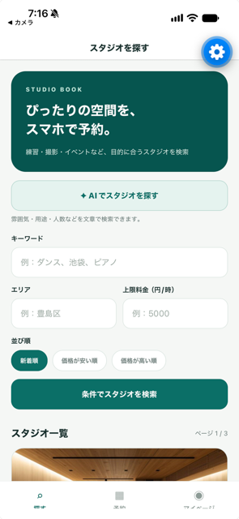
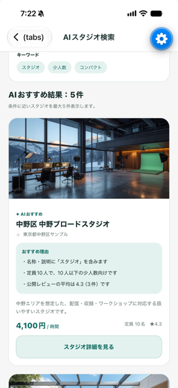
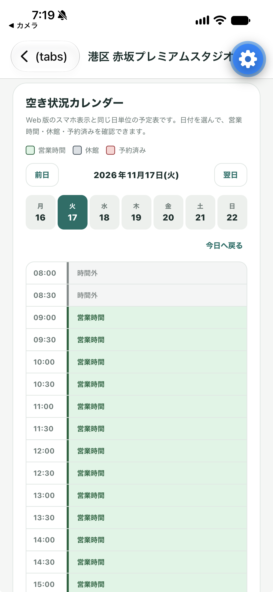
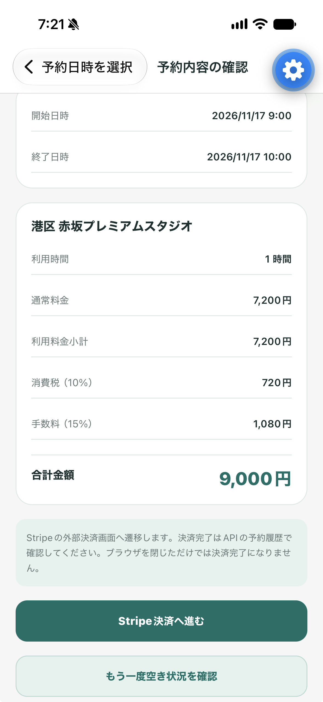
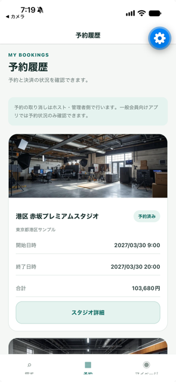

# Studio Book Mobile

**スタジオの検索から予約・決済までをスマートフォンで操作できる、一般会員向けモバイルアプリです。**

[Studio Book Web版](https://github.com/fewioaghwrao/studio-book-dotnet-next) の **ASP.NET Core Web API** を再利用し、[React Native](https://reactnative.dev/) / [Expo](https://expo.dev/) で開発しました。WebViewで既存サイトを表示するのではなく、スマートフォン向けの画面を実装しています。

> **対応プラットフォーム**：iOS / Android向けの共通コード。iOSはExpo Goでの起動・画面確認済み、Android実機での動作検証は別途必要です。掲載画像はiPhoneで取得した画面キャプチャです。

## 画面イメージ

| スタジオ検索 | AIによるスタジオ提案 | スタジオ詳細 |
|:---:|:---:|:---:|
|  |  |  |

| 空き状況カレンダー | 予約確認・料金 | 予約履歴 |
|:---:|:---:|:---:|
|  |  |  |

**[全17枚の画面キャプチャを見る](docs/screenshots.md)**（AI検索、営業時間、レビュー、ログイン、マイページ、Stripe決済画面など）

## 主な機能

| 分類 | 内容 |
|---|---|
| スタジオ検索 | キーワード・エリア・料金条件による一覧検索、詳細表示 |
| AIスタジオ検索 | 自然文から希望条件を解析し、候補・おすすめ理由・日時別の空き状況を表示 |
| 空き状況カレンダー | 日表示で営業時間・予約済み・休館を色分け |
| 予約 | 利用日時選択、空き状況と金額の再確認、予約履歴・決済状況の表示 |
| 決済 | Stripe Checkoutを外部ブラウザで表示（決済結果の確定はサーバー側） |
| レビュー | 公開レビュー・ホスト返信の閲覧、利用済み予約からの投稿、AIレビュー文補助 |
| 会員情報 | 一般会員のログイン・ログアウト、会員情報の表示・編集、パスワード表示切替 |

### 対象とする利用者・機能範囲

- **ログイン可能なのは一般会員（`GeneralUser`）のみ**。`Host` / `Admin` や管理権限を併せ持つアカウントはモバイル側で拒否します。API側での認可も別途必要です。
- **一般会員による予約の取消操作は提供しません。** 取消はホスト・管理者側で行う設計です。一般会員は予約履歴に反映された「キャンセル済み」等の状態を閲覧できます。
- 新規会員登録、パスワード再設定、ホスト・管理者向け機能は対象外です（Web版側の担当範囲）。

## 使用技術

| 領域 | 技術 |
|---|---|
| モバイルUI | React Native、Expo SDK 58、Expo Router、TypeScript |
| 認証 | JWT Bearer、`expo-secure-store` |
| API連携 | HTTPS / REST API（Web版と共通のASP.NET Coreバックエンド） |
| 決済 | Stripe Checkout（外部ブラウザ遷移） |
| テスト | Node.js標準テストランナー（`node --test`）、TypeScript型チェック |
| CI | GitHub Actions（`npm ci` → `npm test` → `npm run typecheck`） |

### システム構成

```text
   iOS / Android
  Studio Book Mobile（React Native / Expo）
       │       └── Stripe Checkout URL → 外部ブラウザ
       │
       └── HTTPS / JWT Bearer
                │
         ASP.NET Core Web API
          ├── スタジオ・空き状況・予約・会員・レビュー
          ├── AI検索・AIレビュー文補助
          └── Stripe決済のサーバー側処理
```

AI用のAPIキーやStripeの秘密鍵はアプリに持たせず、サーバー側で管理する設計です。予約の空き状況・金額は**予約確認APIで再検証**し、画面上の情報だけで確定しません。

## セットアップ・起動

**必要環境**：Node.js 22.13以降、npm、Expo Go（実機で確認する場合）。

```powershell
# リポジトリを取得したらプロジェクト直下で実行
npm ci
Copy-Item .env.example .env
# .env にAPI・Webの公開URLを設定
npx expo start
```

macOS / Linuxの場合、環境変数ファイルのコピーには `cp .env.example .env` を使用してください。

```dotenv
EXPO_PUBLIC_API_BASE_URL=https://your-api.example.com
EXPO_PUBLIC_WEB_BASE_URL=https://your-web.example.com
```

- QRコードをExpo Goで読み取って起動します。LAN接続ではPCとスマートフォン間の通信が必要です。別ネットワークなら `npx expo start --tunnel` を利用できます。
- スマートフォンから見る `localhost` はスマートフォン自身です。PC上でAPIを動かす場合、到達可能なURLを指定してください。
- `.env` はGit管理しません。`EXPO_PUBLIC_*` の値はクライアントから参照可能なので、秘密鍵や資格情報を設定しないでください。
- `app.json` のサンプルBundle ID / Package IDは、ストア配布前に適切な識別子に変更が必要です。

## API連携の例

| 用途 | API |
|---|---|
| 一覧・詳細 | `GET /api/rooms`, `GET /api/rooms/{id}` |
| AIスタジオ検索 | `POST /api/ai/room-search` |
| 予約確認 | `POST /api/reservations/confirm` |
| 予約履歴 | `GET /api/reservations` |
| ログイン・会員情報 | `POST /api/auth/login`, `GET /api/auth/me`, `PUT /api/auth/me` |
| レビュー | `GET /api/rooms/{id}/reviews/new`, `POST /api/rooms/{id}/reviews` |
| AIレビュー文補助 | `POST /api/ai/review-assist` |

APIのレスポンス・アクセス権限・決済確定処理は既存バックエンドが責任を持ちます。Stripe Checkoutからブラウザが戻ったことだけで決済成功とは判定せず、予約履歴の状態を再取得します。

## テスト・CI

```powershell
npm test
npm run typecheck
npx expo install --check
```

- **ローカル実行結果（2026-11-17）**：自動テスト **58件成功 / 失敗0件**、TypeScript型チェック **エラー0件**、Expo依存関係チェック **正常**。
- テスト範囲は予約日時・カレンダー・AI検索・レビューのロジックと、**モックによる認証・API通信・予約確認・Stripe URL遷移の検証**です。
- GitHub Actionsは`main`へのPush / Pull Requestを対象に、Node.js 22で依存関係のインストール、テスト、型チェックを実行する構成です。**CIの最新実行結果はリポジトリのActionsで確認してください。**
- **E2Eテストは今回の対象外**です。モックテストは実API・実決済・Android実機での正しさを保証しません。

## ディレクトリ構成（抜粋）

```text
app/
  (tabs)/                 スタジオ検索・予約履歴・マイページ
  rooms/ai-search.tsx     AIスタジオ検索
  rooms/[id]/             スタジオ詳細・予約・レビュー投稿
  login.tsx               ログイン
  profile-edit.tsx        会員情報編集
src/
  components/             カレンダー、レビュー、共通UI
  lib/                    API、認証、予約、AI検索・決済ロジック
  types.ts                APIレスポンス等の型
tests/                    Node.jsの自動テスト
assets/                   アプリ内で使用する画像
docs/images/              iPhone画面キャプチャ（全17枚）
docs/screenshots.md       画面キャプチャ一覧
.github/workflows/ci.yml  GitHub Actions CI
```

## 設計資料

[要件定義・基本設計・詳細設計・API連携・テスト設計](docs/design/README.md)

## 検証・公開について

画面キャプチャはiOSのExpo Goで取得したものです。Androidの実機・エミュレーター動作、ストア公開、実決済処理はこのREADME上では検証完了とはしていません。一般公開前には実機検証、API側の認可・決済Webhook、スクリーンショット中の個人情報・テストデータの取り扱いを確認してください。
