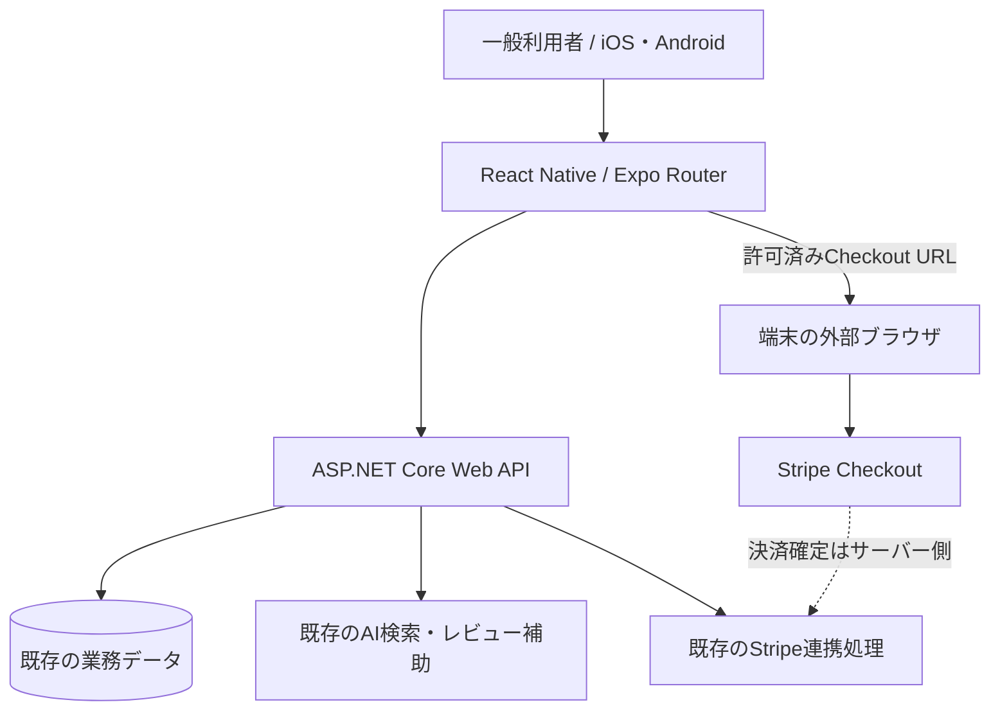
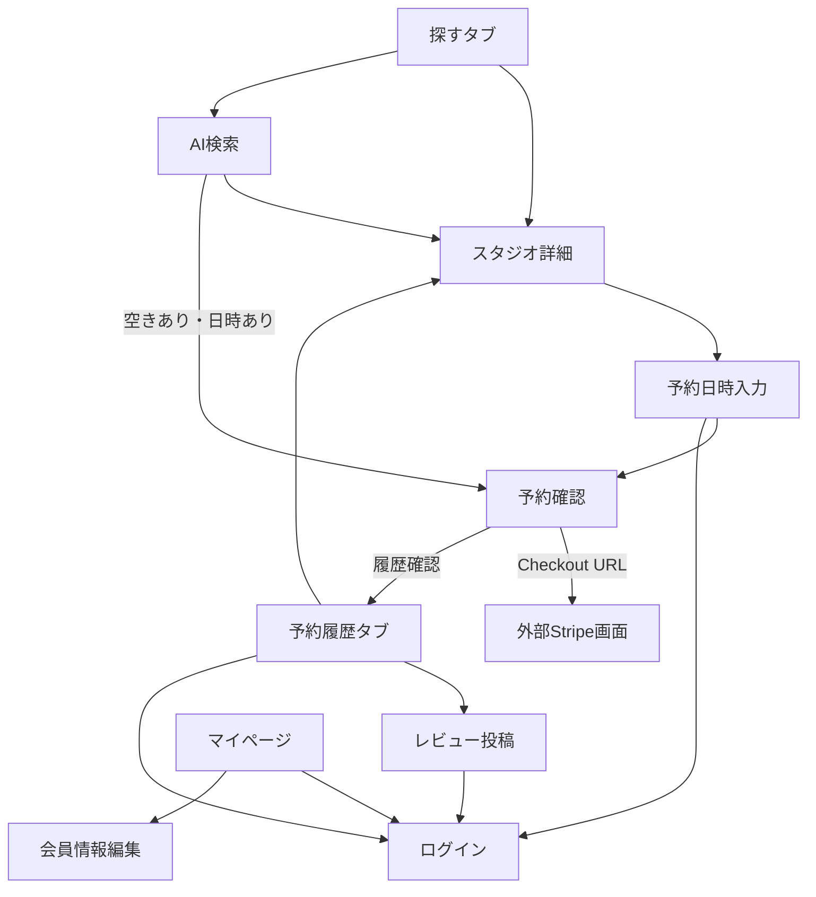

# 基本設計書 — Studio Book Mobile

- 更新日：2026-11-17
- 対象範囲：モバイルの画面／クライアント構成／API境界

## 1. システム構成

**責務分界**

- **モバイル**：入力、画面遷移、表示のための簡易検証、JWTの端末内保存、APIリクエスト、許可URLへのブラウザ遷移。
- **既存API**：認証・認可、予約可能性、料金/税/手数料計算、決済状態、AI検索、レビュー投稿可否の確定。
- **Stripe**：外部Checkout。ブラウザが戻っただけでは決済成功とみなさない。

## 2. 画面構成

| 分類 | ルート | 主な表示・操作 | 認証 |
|---|---|---|---|
| タブ | `/(tabs)/index` | スタジオ検索、一覧、AI検索への導線 | 不要 |
| タブ | `/(tabs)/reservations` | 予約履歴、レビュー投稿への導線 | 一般会員 |
| タブ | `/(tabs)/account` | マイページ、会員表示・編集・ログアウト | 会員機能は一般会員 |
| 画面 | `/rooms/ai-search` | 自然文検索、条件・おすすめ・空き状況 | 不要 |
| 画面 | `/rooms/[id]` | スタジオ詳細、営業時間、カレンダー、レビュー | 不要 |
| 画面 | `/rooms/[id]/book` | 利用開始・終了日時の選択 | 予約操作は一般会員 |
| 画面 | `/rooms/[id]/confirm` | APIによる予約確認、料金内訳、決済導線 | 一般会員 |
| 画面 | `/rooms/[id]/reviews/new` | レビュー閲覧・投稿・AI整文 | 投稿は一般会員 |
| モーダル | `/login` | メール、パスワード、表示切替 | 不要 |
| 画面 | `/profile-edit` | 会員情報更新 | 一般会員 |

### 画面遷移

ログインしていない利用者でもスタジオを探せる。予約履歴・予約確認・レビュー投稿は一般会員へのログインを求める。

## 3. 主要処理フロー

### 3.1 ログイン

1. メールアドレス（前後空白除去）とパスワードを送信。
2. `POST /api/auth/login` がJWTを返す。
3. `expo-secure-store`にJWTを保存した後、`GET /api/auth/me`で本人情報を取得。
4. `GeneralUser`のみで、`Host`/`Admin` を含まないことを確認。
5. 不適切なロール・本人情報未取得時はJWTを削除して失敗とする。
6. 起動時は保存済みJWTがあれば本人情報を再取得する。

### 3.2 通常検索から予約・決済へ

1. 条件を設定して `/api/rooms` を取得。
2. 詳細を `/api/rooms/{id}` から取得し、カレンダーで予定を確認。
3. 利用日時を入力し、ローカル上の過去・逆転・既知衝突を検出。
4. `POST /api/reservations/confirm`で**サーバーに再照会**。
5. サーバー応答で料金内訳とCheckout URLを表示。
6. 許可された HTTPS Checkout URL のみ外部ブラウザで開く。
7. 戻ってきた後、予約履歴を再取得し、決済ステータスを確認。

### 3.3 AI検索から予約確認へ

1. 200文字以内の自然文を `POST /api/ai/room-search` に送信。
2. 解釈条件、推薦理由、空き状況（返却時）を表示。
3. `requestedSlot` があり、当該候補の `availability.isAvailable===true` のときだけ、日時を予約確認画面へ引き継ぐ。
4. 予約確認画面でも必ずサーバー確認を再実施する。

### 3.4 レビュー

1. 予約履歴の利用済み予約からレビュー投稿画面へ進む。
2. サーバーが返す`canReview`と`alreadyReviewed`を元に投稿可能性を表示。
3. 評価とコメントを入力。希望時にはAIレビュー文補助を使用。
4. **AIの結果は利用者が確認・編集**してから投稿。
5. 投稿後にレビューデータを再取得し、二重投稿を防ぐ。

## 4. ナビゲーションと表示

- Expo Routerのファイルベースルーティングを使用。3タブは「探す／予約／マイページ」。
- スタジオ詳細に `RoomCalendar`（日表示）と `RoomReviews` を組み込む。
- リストはページング（通常一覧、予約履歴、レビュー投稿画面の一覧）。
- 日付/時刻入力は `@react-native-community/datetimepicker` を利用。

## 5. UI資料

- [検索トップ](../images/メイン画面1.png)
- [AI検索結果](../images/AIスタジオ検索結果.png)
- [カレンダー](../images/スタジオ詳細カレンダー.png)
- [レビュー](../images/スタジオ詳細レビュー.png)
- [予約確認](../images/スタジオ予約確認3.png)
- [予約履歴](../images/予約履歴.png)

## 6. 非対象機能

予約取消・ホスト管理・管理者機能・新規会員登録・パスワード再設定はモバイルには実装しない。詳細は[要件定義書](requirements-definition.md)参照。
