# Studio Book Mobile — 画面キャプチャ

[iOS / AndroidアプリのREADMEに戻る](../README.md)

添付された**全17枚の画面キャプチャ**を `docs/images/` に収録しています。以下はiPhoneで撮影したアプリ画面です。画像はクリックして拡大できます。

## 1. スタジオを探す

| スタジオ検索トップ | AI検索入力 | AI検索結果 |
|:---:|:---:|:---:|
| <a href="images/メイン画面1.png">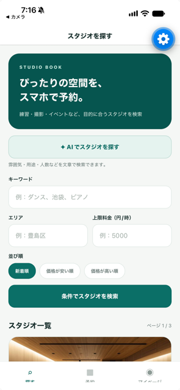</a> | <a href="images/AIでスタジオを探す.png">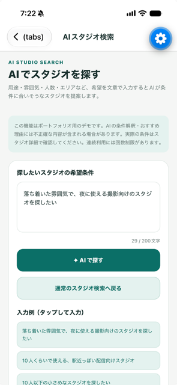</a> | <a href="images/AIスタジオ検索結果.png">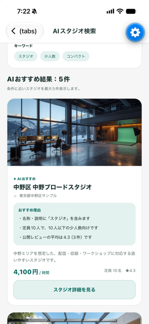</a> |

## 2. スタジオの詳細・空き状況・レビュー

| 詳細 | 営業時間 | カレンダー | レビュー |
|:---:|:---:|:---:|:---:|
| <a href="images/スタジオ詳細.png">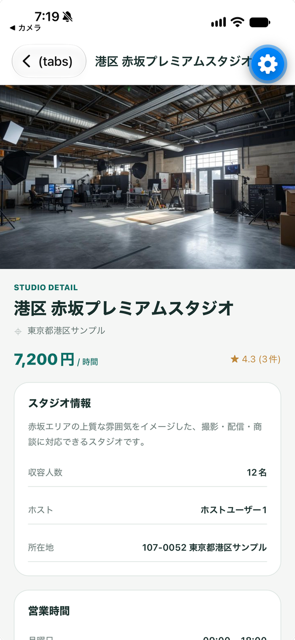</a> | <a href="images/スタジオ詳細営業時間.png">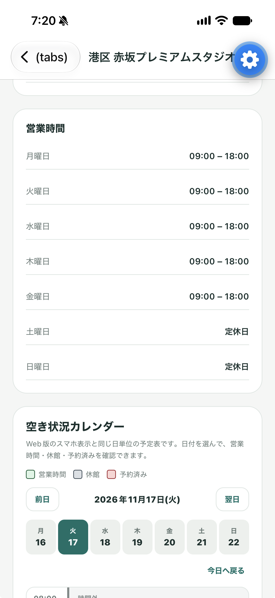</a> | <a href="images/スタジオ詳細カレンダー.png">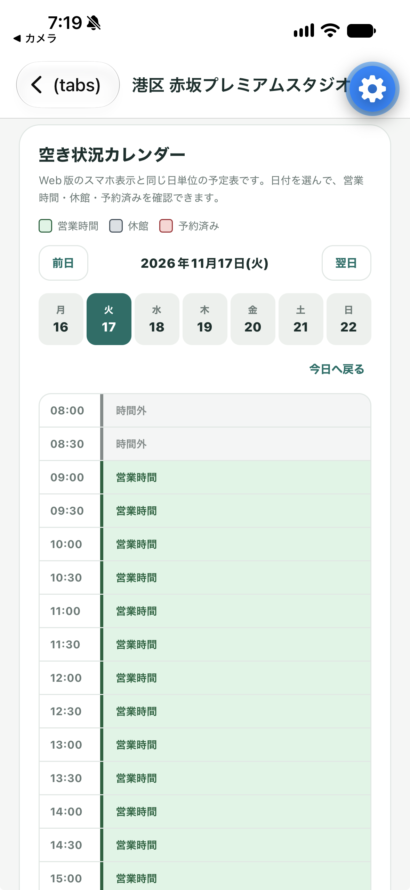</a> | <a href="images/スタジオ詳細レビュー.png">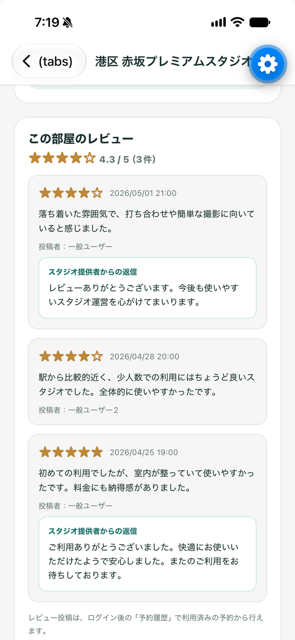</a> |

## 3. 予約・決済

| 予約日時の選択 | 予約内容の確認 | 料金・決済画面へ | Stripe Checkout |
|:---:|:---:|:---:|:---:|
| <a href="images/スタジオ予約１.png">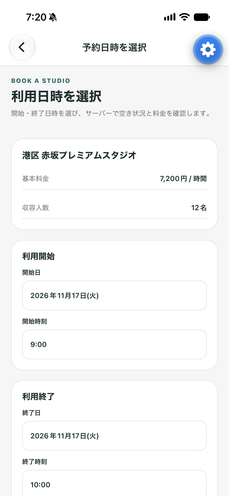</a> | <a href="images/スタジオ予約２.png">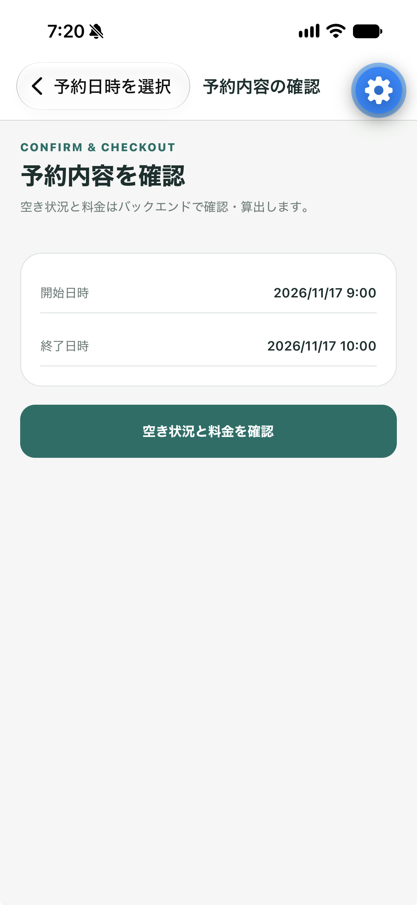</a> | <a href="images/スタジオ予約確認3.png">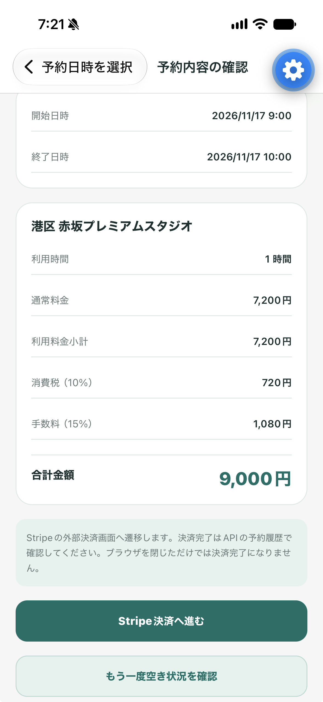</a> | <a href="images/Stripe決済例.png">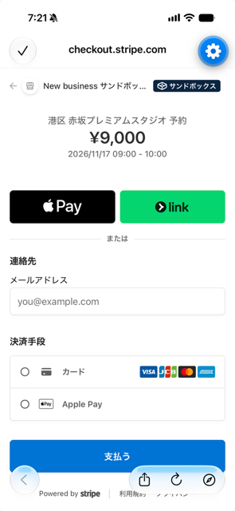</a> |

## 4. ログイン・マイページ・会員情報

| 未ログインのマイページ | ログイン画面 | ログイン後のマイページ |
|:---:|:---:|:---:|
| <a href="images/マイページ画面1.png">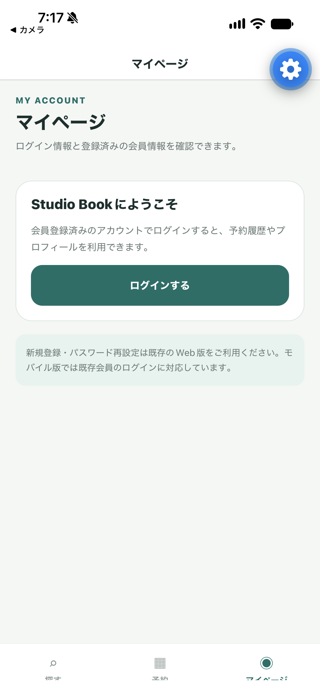</a> | <a href="images/ログイン画面.png">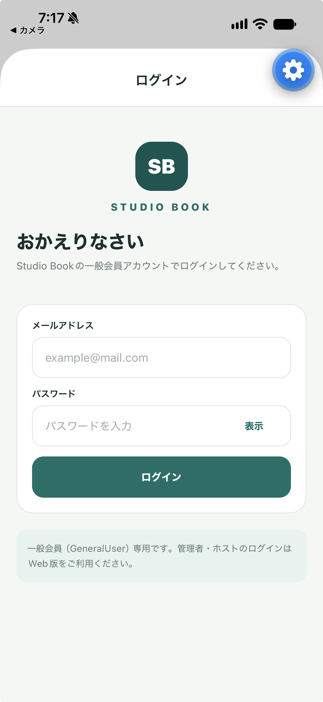</a> | <a href="images/マイページログイン後.png">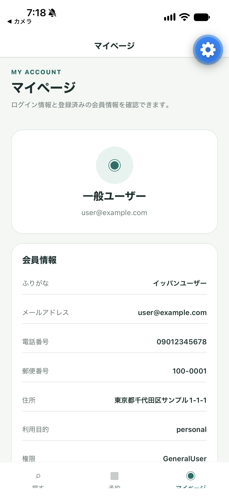</a> |

| 会員情報編集 | ログアウト確認 | 予約履歴 |
|:---:|:---:|:---:|
| <a href="images/会員情報.png">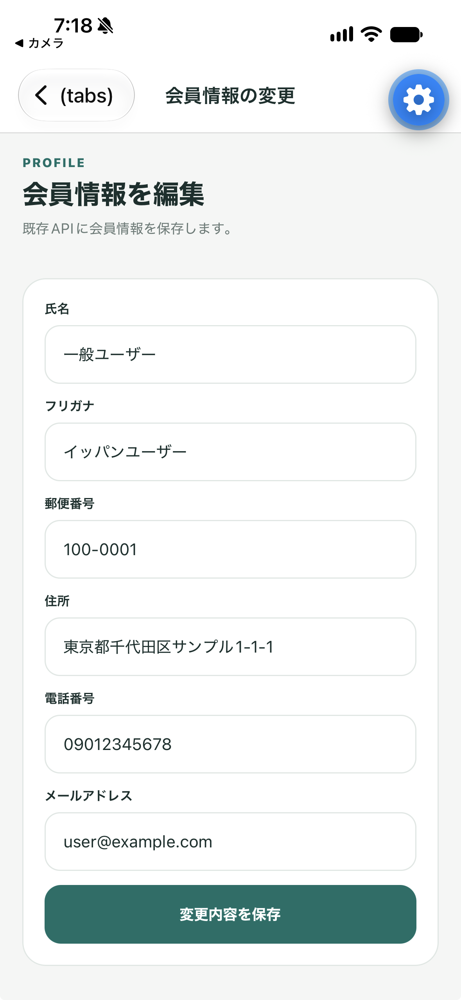</a> | <a href="images/ログアウト.png">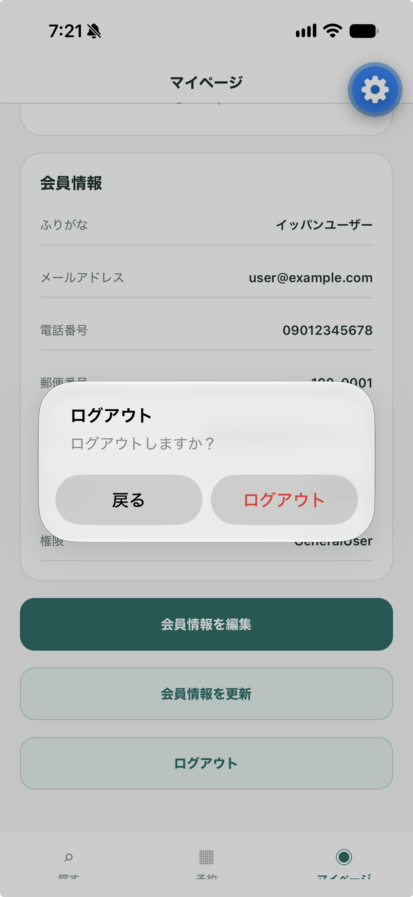</a> | <a href="images/予約履歴.png">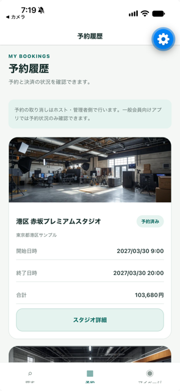</a> |

> **予約取消の仕様**：一般ユーザーのモバイル版に取消操作はありません。ホスト・管理者が取消を行い、一般ユーザーは予約状態を確認します。

> **注意**：公開リポジトリに画像を掲載する前に、氏名・メールアドレス・電話番号・支払い情報などが実在する個人情報でないことを確認してください。
